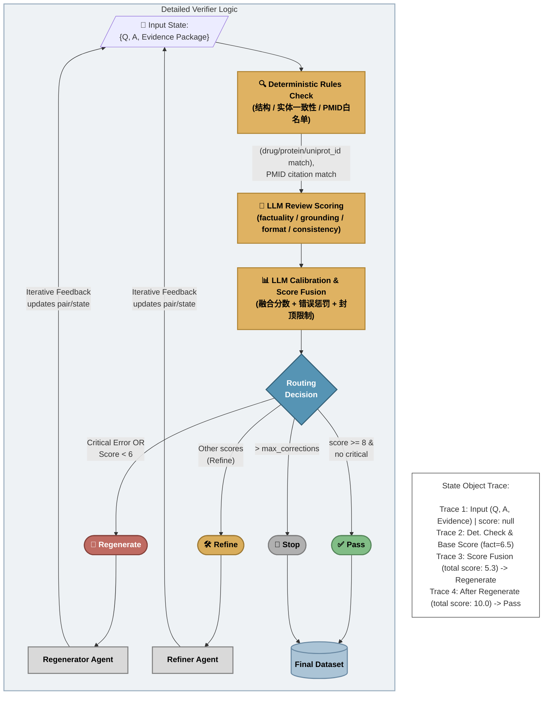

# LangGraph 多智能体协作流程图（basic_drug_interaction）

本文件用于直观展示 `langgraph_pipeline.py` 中多智能体（多节点）协作与路由修正机制。

## 1. 主流程图

```mermaid
flowchart TD
    %% Styling
    classDef workflow fill:#eef2f5,stroke:#9baebf,stroke-width:2px,color:#333
    classDef agent fill:#dfb262,stroke:#b18635,stroke-width:2px,color:#000,font-weight:bold
    classDef decision fill:#5694b4,stroke:#346077,stroke-width:2px,color:#fff,font-weight:bold
    classDef pass fill:#81bd86,stroke:#55865a,stroke-width:2px,color:#000,font-weight:bold
    classDef regenerate fill:#bf6b62,stroke:#85413a,stroke-width:2px,color:#fff,font-weight:bold
    classDef refine fill:#d9ad5b,stroke:#9e7934,stroke-width:2px,color:#000,font-weight:bold
    classDef stop fill:#b0b0b0,stroke:#7d7d7d,stroke-width:2px,color:#000,font-weight:bold
    classDef dataset fill:#abc4d6,stroke:#6888a2,stroke-width:2px,color:#000,font-weight:bold
    classDef sample fill:#ffffff,stroke:#6888a2,stroke-width:2px,color:#333

    InputData[/"Data Pre-processor<br/>(pair输入)"/]
    FinalDataset[("Final High-Quality<br/>QA Dataset<br/>(final_sample)")]
    
    SampleOut["quality_score: 9.85<br/><br/>question:<br/>What is the mechanism...?<br/><br/>answer:<br/>【Core Conclusion】...<br/>【Evidence】...<br/><br/>quality_log:<br/>subscores: ...<br/>critical_errors: []"]
    
    class InputData,FinalDataset dataset
    class SampleOut sample

    subgraph LangGraph["LangGraph Workflow"]
        direction TD
        Start(["Start: {drug, protein, uniprot_id, ...}"])
        
        A["🧲 A: Collector Agent<br/>(Evidence Package Collection)"]
        B["✋ B: Responder Agent<br/>(Structured Generation)"]
        C["🔍 C: Verifier Agent<br/>(Quality Audit)"]
        
        Routing{"Routing<br/>Decision"}
        
        PassBtn(["✅ Pass"])
        RegenBtn(["🔄 Regenerate"])
        RefineBtn(["🛠️ Refine"])
        StopBtn(["🚫 Stop"])
        
        RegenAgent["🔄 Regenerator Agent"]
        RefineAgent["🛠️ Refiner Agent"]
        
        Start --> A
        InputData -->|Question| B
        A -->|Evidence Package| B
        
        B -->|Initial QA Pair| C
        
        C --> Routing
        
        Routing -->|"Pass<br/>(score>=8 & no critical)"| PassBtn
        Routing -->|"> Regenerate<br/>(critical or score<6)"| RegenBtn
        Routing -->|"Refine<br/>(other scores)"| RefineBtn
        Routing -->|"Stop<br/>(> max corrections)"| StopBtn
        
        RegenBtn --> RegenAgent
        RefineBtn --> RefineAgent
        
        RegenAgent -->|Iterative Feedback Loop<br/>(updates pair/state)| C
        RefineAgent -->|Iterative Feedback Loop<br/>(updates pair/state)| C
    end
    
    PassBtn -->|Finalize| FinalDataset
    StopBtn -->|Finalize| FinalDataset
    FinalDataset ~~~ SampleOut

    class LangGraph workflow
    class A,B,C agent
    class Routing decision
    class PassBtn pass
    class RegenBtn regenerate
    class RefineBtn refine
    class StopBtn,RegenAgent,RefineAgent stop
```

## 2. Verifier 内部决策逻辑



## 3. 节点与代码对应

- 图编排入口和边：[langgraph_pipeline.py](file:///c:/Users/JH/Desktop/bioreason_pipeline2.0/bioreason_pipeline/basic_drug_interaction/langgraph_pipeline.py)
- 证据收集（UniProt/ChEMBL/PubMed机制检索）：[langgraph_pipeline.py](file:///c:/Users/JH/Desktop/bioreason_pipeline2.0/bioreason_pipeline/basic_drug_interaction/langgraph_pipeline.py)
- 回答生成（Responder）：[langgraph_pipeline.py](file:///c:/Users/JH/Desktop/bioreason_pipeline2.0/bioreason_pipeline/basic_drug_interaction/langgraph_pipeline.py)
- 质检与路由（Verifier）：[langgraph_pipeline.py](file:///c:/Users/JH/Desktop/bioreason_pipeline2.0/bioreason_pipeline/basic_drug_interaction/langgraph_pipeline.py)
- 修正与重生成（Refiner/Regenerator）：[langgraph_pipeline.py](file:///c:/Users/JH/Desktop/bioreason_pipeline2.0/bioreason_pipeline/basic_drug_interaction/langgraph_pipeline.py)
- 最终出样本（Finalize）：[langgraph_pipeline.py](file:///c:/Users/JH/Desktop/bioreason_pipeline2.0/bioreason_pipeline/basic_drug_interaction/langgraph_pipeline.py)

## 4. 核心 Prompt（当前版本）

### Collector（检索模板，非LLM）

```text
({drug}[Title/Abstract]) AND
(({protein}[Title/Abstract]) OR ({gene}[Title/Abstract])) AND
(mechanism[Title/Abstract] OR "mode of action"[Title/Abstract] OR inhibit*[Title/Abstract] OR bind*[Title/Abstract])
```

### Responder（生成）

```text
You are a biomedical domain writer creating high-quality training samples.
You must answer based only on the provided evidence package.
Do not add facts not supported by provided IDs or snippets.

Output must keep this structure:
【Core Conclusion】...
【Protein Information】...
【Condition】...
【Clinical Significance】...
【Evidence】...

Core Conclusion requirements:
- Explain ONLY how the drug changes the target protein's activity or function.
- Include the interaction type if supported (e.g., inhibitor/agonist/antagonist/binder) and the immediate biochemical consequence (e.g., blocks catalytic activity, prevents phosphorylation).
- Avoid background, definitions, and broad pharmacology in this section.
- Do not include residue positions, numeric constants, binding pocket details, or “typical” claims unless explicitly supported by the evidence package text.

Other constraints:
1) Avoid long bullet stacks. Prefer concise paragraphs.
2) Evidence must cite UniProt, DrugBank and 1-3 PMIDs from the provided list only.
3) Each PMID cited must correspond to at least one concrete mechanism statement in the answer.
4) Always include the UniProt ID and the drug name in 【Protein Information】.
5) If evidence is insufficient, explicitly state uncertainty instead of inventing details.
6) English only.
```

### Verifier（验证）

```text
You are a strict biomedical quality auditor.
Score the answer using only the given question, pair metadata and evidence package.
Return JSON only:
{
  "factuality_score": 0-4,
  "grounding_score": 0-3,
  "format_score": 0-2,
  "consistency_score": 0-1,
  "errors": ["..."],
  "critical_errors": ["..."],
  "revision_advice": ["..."]
}

Factuality rubric (0-4):
0 = core mechanism is wrong or contradicts evidence
1 = major mechanism mismatch or mostly unsupported claims
2 = partially correct direction but key mechanism links unsupported
3 = mostly correct mechanism with minor imprecision
4 = mechanism is directly supported and internally consistent

Critical errors include unsupported evidence, wrong target/drug entity, major biomedical contradiction.
```
