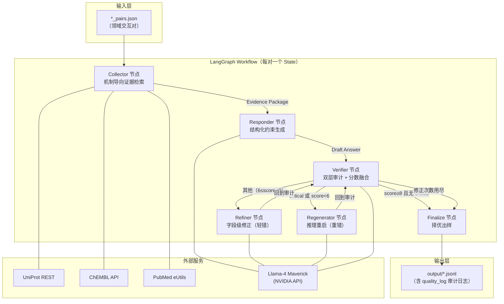

# MedQA-LangGraph（BioReason）项目说明文档

> 基于 MedQA-LangGraph 项目源码的系统性分析（论文另行保存，不在本仓库）。
> 分析日期：2026-10-08

---

## 1. 项目概述

### 1.1 一句话定位

MedQA-LangGraph（内部代号 BioReason）是一个**基于 LangGraph 的多智能体数据集生成框架**，通过"证据约束生成 + 双层验证 + 闭环修正"的编排机制，在不微调任何模型的前提下，批量生产**引文级可溯源**的生物医学交互问答（QA）数据。

### 1.2 研究背景与动机

- 生物医学文献爆炸式增长，人工策展无法扩展；
- LLM 直接生成数据集存在严重幻觉（hallucination），尤其是**引用捏造**（PMID 张冠李戴）；
- 朴素 RAG 存在"上下文漂移"（生成内容脱离检索证据）与"引用错配"（事实正确但引用无关 PMID）两类失败模式。

### 1.3 核心主张（论文三大支柱）

| 支柱                      | 机制                                              | 消融证据（三评估器均值 Δ） |
| ----------------------- | ----------------------------------------------- | -------------- |
| **Verifier-Refiner 闭环** | 生成→审计→按错误分级路由修正→再审计                             | 去掉后总分 −3.95    |
| **PMID 白名单硬校验**         | Python 级确定性约束：引用的 PMID 必须存在于 Collector 检索到的白名单中 | 去掉后总分 −3.47    |
| **结构化输出约束**             | 强制五段式输出，将"推理"与"引用"物理隔离                          | 去掉后总分 −2.67    |

### 1.4 核心成果

- **数据集规模**：22,571 对机制型 QA（四领域：Drug-Target 7,993 / Experimental 4,997 / Pathological 4,988 / Physiological 4,593）；
- **质量**：平均分 8.34/10，Gold（≥8.0）占比 62.0%，Silver（6–8）33.3%，Bronze（<6.0）4.8%（病理模块评分口径已于 2026-10 校准修复，见 `docs/DATA_CALIBRATION.md`）；
- **对外对比**：Evidence Grounding 2.77/3.0，五个对照数据集（ReasonMed / BioGraphletQA / MedQuAD / medical-o1 / ChatDoctor）均低于 1.61；
- **下游效用**：作为 few-shot 示例在 PubMedQA 上比 zero-shot 平均 +10.2%，而 ReasonMed 示例反而 −3.8%。

### 1.5 技术栈

| 层      | 技术                                                                            |
| ------ | ----------------------------------------------------------------------------- |
| 智能体编排  | LangGraph（StateGraph + 条件路由边）                                                 |
| 生成模型   | Llama-4 Maverick 17B（NVIDIA API：`integrate.api.nvidia.com`）                   |
| 独立评估   | DeepSeek-V3、Qwen2.5-72B（SiliconFlow）、GPT-4o（OpenAI 兼容代理）                      |
| 证据源    | UniProt REST、ChEMBL Web API、PubMed E-utilities（esearch/esummary/efetch/elink） |
| 并发与容错  | ThreadPoolExecutor + 线程锁 + JSONL 断点续传（checkpoint/resume）                      |
| 语言/运行时 | Python 3.10+，openai SDK，requests                                              |

---

## 2. 架构设计

### 2.1 总体架构图



### 2.2 状态机设计

全局状态由 `PipelineState`（TypedDict，`langgraph_pipeline.py:36-48`）承载：

```python
class PipelineState(TypedDict, total=False):
    pair: dict              # 输入交互对（drug/protein/uniprot_id/...）
    question: str           # 由模板生成的自然语言问题
    evidence: dict          # 证据包（uniprot/chembl/pubmed_*）
    answer: str             # 当前轮次回答
    best_answer: str        # 历史最优回答
    best_score: float       # 历史最优分数
    verification: dict      # 审计结果（分数/子分/错误/建议）
    route: str              # pass | refine | regenerate | stop
    correction_count: int   # 已修正轮数
    max_corrections: int    # 修正预算（默认2）
    final_sample: dict      # 最终输出样本
    elapsed_seconds: float
```

图编排（`build_graph()`）：

```
collect → generate → verify → (条件路由) → {pass|stop} → finalize → END
                                ↘ refine  ↗
                                ↘ regenerate ↗
```

### 2.3 关键设计决策

1. **确定性优先于概率性**：Verifier 先跑 Python 规则检查（确定性），再跑 LLM 语义评审；两者分数融合时**取较小值**（保守策略），确保规则能"封顶"LLM 的乐观偏差。
2. **错误分级路由**（Discriminative Routing）：格式级轻错走 Refiner（便宜），语义级重错走 Regenerator（昂贵），把最贵的算力留给最难的样本。
3. **择优保留**：每轮 verify 后记录 `(best_score, best_answer)`，Finalize 时即使最终轮降分也输出历史最优，防止闭环"越修越差"。
4. **生成与验证同模型但职责隔离**：Responder 与 Verifier 使用同一 backbone（Llama-4 Maverick），但通过差异化的系统提示词（writer vs. strict auditor）实现角色分工；外部评估实验（DeepSeek/Qwen/GPT-4o）另用独立模型，避免自评偏置。

---

## 3. 模块功能说明

### 3.1 目录总索引

```
run-bdi/
├── AGENTS.md / CLAUDE.md      # AI 协作规则（项目身份、文件地图、红线）
├── HANDOVER.md                # 项目交接文档（历史坑与血泪史）
├── MULTI_AGENT_FLOW.md        # 多智能体流程 Mermaid 图 + 核心 Prompt
├── METHOD_PAPER_STYLE.md      # 论文方法章节写作风格约定
├── paper_modification_tracking.md  # 论文修改追踪（强制规则）
├── PROJECT_DOCUMENTATION.md   # 本文档
│
├── basic_drug_interaction/         # 领域①：药物-靶点互作（主参考实现，LangGraph）
├── basic_experimental_conditions/ # 领域②：实验条件（LangGraph）
├── basic_pathological_environment/# 领域③：病理环境（LangGraph）
├── basic_physiological_conditions/# 领域④：生理条件（LangGraph）
├── complex_combination_therapy/    # 领域⑤：联合用药（普通函数式管线，未入论文统计）
│
├── evaluation/          # 与5个外部数据集的横向对比评估
├── experiments/         # 基准对比 + 消融实验 + 下游效用（核心实验资产）
├── output/              # 消融实验汇总结果（json）
│
├── paper_stats.py       # 数据集统计（Gold/Silver/Bronze、路由分布、错误类型）
├── deduplicate.py / check_duplicates.py / check_combo_dups.py   # 去重与查重
├── evaluate_quality.py / quality_check_combo.py / eval_physio.py # 质量抽检
├── check_truncation.py / analyze_data_drift.py / check_answer_diversity.py # 数据体检
├── filter_physio.py / clean_combo_output.py    # 领域数据清洗
└── progress_report.html / 引文验证报告.docx  # 过程文档
```

### 3.2 五个领域生成模块

四个 LangGraph 模块共享同一骨架（collect → generate → verify → 路由闭环 → finalize），差异集中在**问题模板、输入字段、五段式小节命名、确定性检查项**：

| 维度          | drug_interaction（主实现）                                        | experimental_conditions                                        | pathological_environment                                       | physiological_conditions                               | combination_therapy                                                    |
| ----------- | ------------------------------------------------------------ | -------------------------------------------------------------- | -------------------------------------------------------------- | ------------------------------------------------------ | ---------------------------------------------------------------------- |
| 架构          | LangGraph                                                    | LangGraph                                                      | LangGraph                                                      | LangGraph                                              | 普通函数式                                                                  |
| 问题模板        | `What is the mechanism by which {drug} affects {protein}?`   | `How does {condition} affect {protein} activity and function?` | `How does {pathology} in {disease} affect {protein} function?` | `What is the function of {protein} under {condition}?` | `What is the synergistic mechanism of {drugs} in {scene}?`             |
| 输入 pair 字段  | drug / protein / uniprot_id / gene / chembl_id / drugbank_id | condition / protein / uniprot_id                               | disease / pathology / protein / uniprot_id                     | condition / protein / uniprot_id                       | drug_combination / therapeutic_area / target_protein / uniprot_ids（多值） |
| 第4小节        | 【Clinical Significance】                                      | 【Clinical Relevance】                                           | 【Clinical Significance】                                        | 【Physiological Importance】                             | 无（四段式）                                                                 |
| category 输出 | Basic-Drug Interaction                                       | （实验条件类）                                                        | （病理环境类）                                                        | （生理条件类）                                                | Complex-Combination Therapy                                            |
| 特有检查        | residue/IC50/ATP 无证据细节检测                                     | 非英文内容检查                                                        | disease/protein/uniprot 三重一致性                                  | 证据引用仅允许白名单 PMID                                        | 多靶点适配                                                                  |
| 输入规模        | 7,993 对（已产出）                                                 | 4,997                                                          | 4,988                                                          | 4,593（另有 filtered_high_quality.jsonl）                  | 约2.7MB pairs                                                           |

> 注：`basic_experimental_conditions` 目录内同时存在 `pipeline.py`（历史版本）与 `langgraph_pipeline.py`（当前版本）；`complex_combination_therapy` 尚未迁移到 LangGraph。

### 3.3 evaluation/（横向对比）

- **数据**：从本数据集与 5 个对照数据集（ReasonMed / BioGraphletQA / MedQuAD / medical-o1 / ChatDoctor）各随机抽 100 条；
- **脚本**：`biomed_eval.py`（单条评估）、`run_comparison_eval*.py`（批量对比）、`restore_full_answers.py`（修复300字符截断问题——曾导致 Grounding 分被误判为1.1）、`plot_comparison_figure.py`（论文 Fig.3 绘图）；
- **结果**：`comparison_data/` 下各数据集 × 三评估器的逐条评分与统计。

### 3.4 experiments/（论文核心实验）

| 子目录                      | 内容                                                                                                                             | 对应论文    |
| ------------------------ | ------------------------------------------------------------------------------------------------------------------------------ | ------- |
| `baseline_comparison/`   | Vanilla LLM / Standard RAG / RAG+Query Rewrite / Iterative RAG 四基线（n=100）                                                      | Table 3 |
| `ablation_study/`        | Full / w/o Retrieval / w/o Correction Loop / w/o Struct Constraint / w/o PMID Whitelist 五变体（n=200），`run_all_ablations.py` 一键串联 | Table 4 |
| `downstream_utility/`    | PubMedQA few-shot 迁移实验（n=99，三条件）                                                                                               | Table 6 |
| `biographletqa/`         | 974MB BioGraphletQA 原始数据的抽样与评估支撑                                                                                               | Fig. 3  |
| `shared/`                | `evaluator.py`（三评估器统一评分器，含断点续传）与 `api_config.py`                                                                               | —       |
| `experiments_summary.md` | **所有实验的黄金数据源**（数字的唯一依据）                                                                                                      | —       |

---

## 4. 使用指南

### 4.1 环境准备

```bash
pip install langgraph openai requests
```

API 密钥通过环境变量注入（详见 §6.3 安全建议）：

```bash
export BIOREASON_API_KEY="nvapi-..."      # 生成模型（NVIDIA）
export SILICONFLOW_API_KEY="sk-..."       # DeepSeek/Qwen 评估
export OPENAI_API_KEY="sk-..."            # GPT-4o 评估
```

### 4.2 运行数据生成管线（以药物-靶点模块为例）

```bash
cd basic_drug_interaction

# 试跑 3 条
python langgraph_pipeline.py --count 3

# 批量：跳过前1000条，跑 [1000, 2000)，8 并发，修正预算2轮
python langgraph_pipeline.py --start 1000 --end 2000 --workers 8 --max-corrections 2

# 指定输出文件（自动 .json → .jsonl）
python langgraph_pipeline.py --count 5 --output output/langgraph_batch_output_eval5.json
```

**命令行参数**：

| 参数                  | 默认                                   | 说明                     |
| ------------------- | ------------------------------------ | ---------------------- |
| `--count`           | 无                                    | 从 start 起取前 N 条（测试用）   |
| `--start` / `--end` | 0 / 末尾                               | 输入 pair 切片             |
| `--workers`         | 3                                    | ThreadPoolExecutor 并发数 |
| `--output`          | `output/langgraph_batch_output.json` | 输出路径（实际写 .jsonl）       |
| `--max-corrections` | 2                                    | 闭环修正预算                 |

**断点续传**：重启时自动读取已有 .jsonl，按 `drug::protein` 键跳过已完成样本，仅增量运行。

### 4.3 运行实验

```bash
# 消融实验（一键串联：抽样 → 4个降级变体生成 → 评估）
cd experiments/ablation_study
python run_all_ablations.py --count 200 --evaluators deepseek qwen gpt4o

# 基线对比
cd ../baseline_comparison
python run_all_baselines.py

# 统计显著性
python ../compute_statistical_significance.py
```

### 4.4 数据集统计与体检

```bash
python paper_stats.py                        # 各模块 output/ 下的质量分层统计
python deduplicate.py                       # 跨模块去重
python check_truncation.py                   # 截断检测
python check_answer_diversity.py            # 答案多样性检测
```

### 4.5 输出样本格式

```json
{
  "question": "What is the mechanism by which Imatinib affects BCR-ABL?",
  "answer": "【Core Conclusion】Imatinib inhibits BCR-ABL tyrosine kinase activity...\n\n【Protein Information】...\n\n【Evidence】...",
  "category": "Basic-Drug Interaction",
  "drug": "Imatinib",
  "protein": "BCR-ABL",
  "uniprot_id": "P00519",
  "quality_score": 10.0,
  "quality_log": {
    "last_route": "pass",
    "correction_count": 0,
    "subscores": {
      "factuality_base": 4.0,        // 规则层事实基准分
      "factuality_llm_raw": 4.0,     // LLM 原始事实分
      "factuality_effective": 4.0,   // 融合后有效事实分
      "grounding_llm_raw": 3.0,
      "format_llm_raw": 2.0,
      "consistency_llm_raw": 1.0
    },
    "errors": [],
    "critical_errors": []
  },
  "elapsed_seconds": 23.6
}
```

质量分层：**Gold ≥ 8.0** / **Silver 6.0–8.0** / **Bronze < 6.0**。

---

## 5. 关键技术细节

### 5.1 Collector：机制导向三级检索

`node_collect` 的检索策略（以 drug_interaction 为例）：

1. **结构化锚点**：`fetch_uniprot_core()` 取蛋白功能/通路/催化活性/关键词；`fetch_chembl_drug_mechanisms()` 取药物机制记录（带 target_hint 启发式打分排序）；
2. **PubMed 机制检索**（主查询，retmax=30）：
   
   ```
   ({drug}[Title/Abstract]) AND (({protein}[Title/Abstract]) OR ({gene}[Title/Abstract]))
   AND (mechanism[Title/Abstract] OR "mode of action"[Title/Abstract]
        OR inhibit*[Title/Abstract] OR bind*[Title/Abstract])
   ```
3. **三级降级**（候选 <3 时依次触发）：去掉机制限定 → 自然语言式查询 → 基因名查询；
4. **标题启发式重排**（`rank_pmid`）：token 命中 +1.0 / mechanism +0.6 / inhibit +0.4 / bind +0.3 / resistance −0.4 / review −0.2，取 Top-6 进白名单、Top-3 抓取 XML 摘要（abstract 截断 1200 字符）。

### 5.2 Verifier：双层审计与分数融合

**第一层：确定性规则检查**（`deterministic_checks`）

| 检查项                                     | 类型           | 后果                     |
| --------------------------------------- | ------------ | ---------------------- |
| 五段式小节齐全                                 | error        | format_score = 2 − 缺失数 |
| drug / protein / uniprot_id 出现于答案       | error        | consistency_score = 0  |
| **PMID 白名单**：答案中 PMID ∉ 证据白名单           | **critical** | grounding_score = 0    |
| Evidence 段无任何 PMID                      | error        | grounding_score = 1    |
| 无证据支撑的残基号 / IC50/Ki/Kd / ATP-binding 断言 | **critical** | 触发 regenerate          |

**第二层：LLM 语义评审**（temperature=0.0，返回 JSON：factuality 0-4 / grounding 0-3 / format 0-2 / consistency 0-1 + errors / critical_errors / revision_advice）。

**分数融合公式**（`node_verify`）：

```
factuality_base：
  有 critical           → 0（仅 unsupported_pmids 且 LLM factuality≥3 时放宽为 2）
  实体名不一致          → 1
  缺 Evidence PMID / LLM错误≥3 → 2
  无任何错误            → 4
  其余                 → 3

factuality_effective = clip(factuality_base ± 1, 0, 4)   # LLM≥3.5加1，≤1.5减1

blended = factuality_effective
        + min(LLM grounding, det grounding)      # 保守取小
        + min(LLM format,    det format)
        + min(LLM consistency, det consistency)
        − min(1.5, 0.25×|det_errors| + 0.15×|llm_errors|)   # 错误惩罚
有 critical → blended 封顶 5.9
```

**路由决策**：

```
score ≥ 8.0 且无 critical        → pass（出库）
correction_count ≥ max（默认2）   → stop（择优出库）
有 critical 或 score < 6.0       → regenerate（推理重启，附 critical 提示）
其他（6 ≤ score < 8）            → refine（按 revision_advice 字段级修正）
```

### 5.3 生成侧约束（Responder）

- 系统提示词强制五段式 + 六条约束（禁用白名单外 PMID、证据不足须显式声明等）；
- 后处理 `normalize_sections()`：重排小节顺序、剔除重复；
- `normalize_evidence_citations()`：PubMed:xxx 归一化为 PMID:xxx，Evidence 段尾部自动补齐去重后的 PMID 后缀（至多4个）。

### 5.4 并发与容错

- `run_batch`：ThreadPoolExecutor（默认3线程）+ 文件锁串行写 JSONL；
- 每条样本独立 try/except，单条失败不阻塞批次（失败记录含 error 字段）；
- 评估器 `evaluate_batch`（`experiments/shared/evaluator.py`）：8 并发 + 3 次重试（429 退避 15s/30s/45s）+ 逐条实时 flush 的 checkpoint 文件（应对 GPT-4o 403 余额中断导致的全量丢失事故）。

### 5.5 评估协议（外部实验）

三独立评估器（DeepSeek-V3 / Qwen2.5-72B / GPT-4o），统一提示词三维度评分：Factuality 0-4（步长0.5）+ Granularity 0-3 + Grounding 0-3，总分 10。正则解析输出。三评估器成对 Pearson 均值 r=0.915，保证协议可靠性。统计检验：配对 t 检验 + Holm-Bonferroni 校正 + Bootstrap 95% CI（`compute_statistical_significance.py`）。

---

## 6. API 接口文档

### 6.1 内部函数 API（langgraph_pipeline.py）

| 函数                     | 签名                                                               | 说明                               |
| ---------------------- | ---------------------------------------------------------------- | -------------------------------- |
| `build_graph`          | `() -> CompiledGraph`                                            | 编译 LangGraph 状态图（六节点+条件边）        |
| `run_one`              | `(app, pair, max_corrections=2) -> dict`                         | 单对执行，返回 final_sample             |
| `run_batch`            | `(pairs, output_file, max_corrections=2, max_workers=3) -> list` | 批量执行 + 断点续传                      |
| `node_collect`         | `(state) -> state`                                               | 证据收集（UniProt+ChEMBL+PubMed）      |
| `node_generate`        | `(state) -> state`                                               | 结构化生成（temp=0.2, max_tokens=1500） |
| `node_verify`          | `(state) -> state`                                               | 双层审计 + 分数融合 + 路由决策               |
| `node_refine`          | `(state) -> state`                                               | 字段级修正（temp=0.2, max_tokens=1700） |
| `node_regenerate`      | `(state) -> state`                                               | 推理重启（temp=0.15, max_tokens=1700） |
| `node_finalize`        | `(state) -> state`                                               | 择优输出 final_sample                |
| `deterministic_checks` | `(state) -> dict`                                                | 规则层审计（返回子分+错误列表）                 |
| `normalize_sections`   | `(answer) -> str`                                                | 五段式结构归一化                         |
| `extract_pmids`        | `(text) -> list[str]`                                            | 提取文本中的 PMID                      |
| `parse_json_object`    | `(text) -> dict`                                                 | 从 LLM 输出解析 JSON（正则法）             |

### 6.2 外部服务 API 依赖

| 服务              | 端点                                                                          | 用途                   | 超时     |
| --------------- | --------------------------------------------------------------------------- | -------------------- | ------ |
| UniProt REST    | `rest.uniprot.org/uniprotkb/{id}.json`                                      | 蛋白功能/通路/催化           | 20s    |
| ChEMBL          | `ebi.ac.uk/chembl/api/data/molecule/{id}.json`<br>`.../drug_mechanism.json` | 药物分子/机制记录            | 15-20s |
| PubMed esearch  | `eutils.ncbi.nlm.nih.gov/.../esearch.fcgi`                                  | PMID 检索（retmax=30）   | 15s    |
| PubMed esummary | `.../esummary.fcgi`                                                         | 批量标题                 | 20s    |
| PubMed efetch   | `.../efetch.fcgi`                                                           | 摘要 XML / PMC 全文      | 20-30s |
| PubMed elink    | `.../elink.fcgi`                                                            | PMID→PMCID 映射        | 20s    |
| NVIDIA LLM      | `integrate.api.nvidia.com/v1`（OpenAI 兼容）                                    | Llama-4 Maverick 17B | 45s    |

所有请求带 `User-Agent: BioReasonPipeline/0.1` 标识。

### 6.3 评估器 API（experiments/shared/evaluator.py）

```python
from shared.evaluator import evaluate_batch, summarize

# 批量评估：model ∈ {"deepseek", "qwen", "gpt4o"}
results = evaluate_batch(items, model="deepseek", max_workers=8,
                         checkpoint_file="ckpt.jsonl")  # 断点续传

# 按 variant 分组汇总均值
summary = summarize(results)
# → {variant: {n, mean_factuality, mean_granularity, mean_grounding, mean_total}}
```

**安全提醒**：当前 `api_config.py` 与部分管线源码中硬编码了三个明文 API 密钥（NVIDIA / SiliconFlow / OpenAI），详见 §7.1。

---

## 7. 项目审查：问题、瓶颈与优化建议

### 7.1 🔴 高优先级问题

**P1. API 密钥明文硬编码（安全）**

- 位置：`basic_drug_interaction/langgraph_pipeline.py:27`（NVIDIA 密钥）、`experiments/shared/api_config.py`（NVIDIA + SiliconFlow + OpenAI 三密钥，且 OpenAI 走第三方代理 `proaiapi.tech`）；
- 风险：密钥已随代码库泄露；若项目开源（论文承诺 data availability）将直接暴露；
- 建议：**立即在三个平台吊销并轮换密钥**；改为纯环境变量读取（去掉默认值兜底）；加入 `.gitignore` 保护；历史 git 记录需用 BFG 清洗。

**P2. 论文与代码实现不一致（学术严谨性）**

论文 §3.7 声称的实现细节在代码中不存在：

| 论文声明                                  | 代码实际                                                        |
| ------------------------------------- | ----------------------------------------------------------- |
| Celery + Redis 异步 worker 池            | ThreadPoolExecutor（3-8线程）                                   |
| SQLite 缓存层                            | 无任何缓存                                                       |
| 严格 3 req/s 限流（ChEMBL/PubMed）          | 无限流实现                                                       |
| 8,000 token 溢出时动态注入递归摘要节点             | 无该节点                                                        |
| A100 本地 GPU 集群 + bitsandbytes 4bit 量化 | 远程 API 调用（NVIDIA integrate API） |

- 风险：审稿人复现失败或质疑；
- 建议：或者补齐工程实现（SQLite 缓存与限流收益明确，值得做），或者修改论文 §3.7 如实描述为"线程池并发 + 远程推理 API"。**论文数字本身有 `experiments_summary.md` 逐条对应，这部分是可靠的。**

**P3. 失败样本污染断点续传（正确性 bug）**

`run_batch` 中单条异常时返回 `{"error":..., "drug":..., "protein":...}` 并**同样写入 JSONL**；重启续跑时按 `drug::protein` 跳过已完成——失败样本会被误判为"已完成"而**永远不被重试**，且污染下游统计（`paper_stats.py` 靠 `answer` 为空过滤，但去重/其他脚本未必）。

- 建议：error 记录不写入主输出（或写入独立 `failures.jsonl`），resume 集合只统计成功记录。

### 7.2 🟡 中优先级问题

**P4. 五模块代码复制粘贴（可维护性）**

四个 LangGraph 模块各为 ~32-45KB 的完整副本，评分融合、路由、后处理逻辑几乎相同；一处 bug 修复需五处同步（历史上生理条件模块曾因提示词过度约束 + 后处理过度导致 111s/条与 PMID 格式错误，事后修复并未回流到其他模块）。

- 建议：抽取 `core/` 共享库（图构建、评分融合、后处理、批处理），模块只保留领域配置（问题模板、小节名、特有检查项、输入 schema）。预计可削减 70%+ 代码量。

**P5. LLM 输出解析脆弱**

- `parse_json_object` 用贪婪正则 `\{[\s\S]*\}`，LLM 输出含多 JSON 块或代码围栏时可能解析失败（静默返回 `{}`，导致所有子分默认 1 分）；
- 评估器 `_parse` 正则失败时子分默认 0.0；
- 建议：使用 OpenAI SDK 的 `response_format={"type":"json_object"}`（NVIDIA API 支持）或 json_repair 库；解析失败应显式重试而非静默降级。

**P6. 主管线 LLM 调用无重试**

`llm_call` 超时 45s 单次不重试；网络抖动即触发 P3 的失败路径。评估器已有 3 次退避重试，主管线应同样配备。

**P7. 评分融合魔数硬编码**

`5.9 封顶`、`±1 校准`、`0.25/0.15 惩罚系数`、`max(1.5)` 等全部内联。这些是论文核心公式（Eq.1 的工程化），却无任何配置化或注释说明取值依据。

- 建议：提取为模块级常量并注释设计理由，便于消融与复现。

**P8. `complex_combination_therapy` 架构漂移**

该模块仍是普通函数式管线（非 LangGraph），五段式变四段式，未纳入论文 22,571 统计。若论文未来扩展到联合用药（Discussion 已提及组合疗法是 future work），需先完成迁移。

### 7.3 🟢 性能瓶颈

**B1. 检索为串行同步链**：单样本内 UniProt → ChEMBL → PubMed esearch → esummary → efetch(×3) 串行执行，5-8 次网络往返；线程池仅 3-8 并发，22,571 样本理论下限受 API 延迟支配（论文均值 33.8s/样本与此吻合）。

- 优化：a) asyncio + aiohttp 改造（LLM 与检索天然 IO 密集，预计 5-10× 吞吐）；b) 证据三源并发请求；c) Top-3 摘要抓取并发化。

**B2. 无缓存层**：同一蛋白（如 EGFR 出现 389 次）的 UniProt/ChEMBL/常见 PubMed 查询被重复拉取数千次。

- 优化：SQLite/磁盘缓存（key = 服务+参数），热门实体命中率预计 >60%，可直接削减平均延迟与外网依赖。

**B3. 无 NCBI 限流**：E-utilities 政策为 3 req/s（无 API key），8 并发下高峰可达 ~10 req/s，有被 403/封禁风险（`api_error.txt` 的存在暗示已遭遇过）。建议加令牌桶限流器并申请 NCBI API key（10 req/s）。

**B4. 全量状态在 LangGraph state 中传递**：evidence 包（含摘要全文）每轮 refine/regenerate 重复进入 prompt，复杂病理样本上下文膨胀。建议证据包分级（核心摘要 vs 全文摘录）并按轮次裁剪。

### 7.4 工程质量与可复现性

- **无单元测试**：`deterministic_checks` / `normalize_sections` / `rank_pmid` / `parse_json_object` 均为纯函数，是理想的测试对象；建议用 pytest 覆盖（特别是 P5 的解析边界）。
- **数据文件版本混乱**：`*.jsonl.bak` 与正式文件并存于 output/，且 `.bak`（13MB）反而大于正式文件（5MB）——清理策略缺失。建议 DVC/git-LFS 管理数据，产出目录只保留最终版。
- **`__pycache__` 提交风险** + `filtered_ds.jsonl`（974MB）与 `.git` 目录混在项目树中，开源前需整理 `.gitignore`。
- **密钥轮换后**，`HANDOVER.md` 记载的"300字符截断事故"与"403中断事故"说明缺少集成冒烟测试（smoke test）：建议 `experiments/downstream_utility/smoke_test.py` 的模式推广到主管线（--count 3 全链路验证）。
- **评估一致性**：`restore_full_answers.py` 修复截断的教训值得固化为评估前置断言（答案长度 < 500 字符即告警）。

### 7.5 数据层面观察

- 药物-靶点模块 Gold 率 47.6% 显著低于其他三域（81.5%/59.9%/88.4%）：与其说框架问题，不如说互作机制的文献密度分布决定；`suggestion.md` 与论文 case study 的结论一致。
- 病理环境 Bronze 9.0%（最高）：多因素耦合（TME、缺氧）导致证据稀疏 → 修正预算耗尽。可针对性提高该域 `--max-corrections` 至 3 或扩充证据检索深度（Top-6 → Top-10）。
- 重复检查脚本已齐备（`check_duplicates.py` 等），建议固化为 CI 式一键数据体检入口。

### 7.6 优化路线图（建议优先级）

| 阶段  | 动作                                                                       | 解决               |
| --- | ------------------------------------------------------------------------ | ---------------- |
| 立即  | 吊销/轮换三密钥；环境变量化；.gitignore                                                | P1               |
| 短期  | 失败样本不进续传集合；llm_call 加重试；JSON mode 解析                                     | P3/P5/P6         |
| 中期  | 抽取共享核心库；SQLite 缓存 + NCBI 限流；asyncio 化                                    | P4/B1-B3         |
| 长期  | 组合疗法迁移 LangGraph；NLI 二级语义蕴含校验（论文 Limitation 已规划）；多模态证据（AlphaFold/SMILES） | P8/论文Future Work |

---

## 8. 结论

MedQA-LangGraph 证明了"**证据约束的多智能体编排可以在零微调前提下将生物医学 QA 生成的证据溯源能力推向满分**"这一核心命题，实验设计（三独立评估器、五数据集横向对比、五变体消融、下游迁移）完整且数字可溯源。代码侧的主要短板集中在工程卫生（密钥、复制粘贴、测试缺失）与论文-实现一致性两处；检索缓存、限流与异步化是投入产出比最高的下一步优化。项目已具备开源（论文 data availability 承诺）前需要完成的安全整改清单，见 §7.1。
